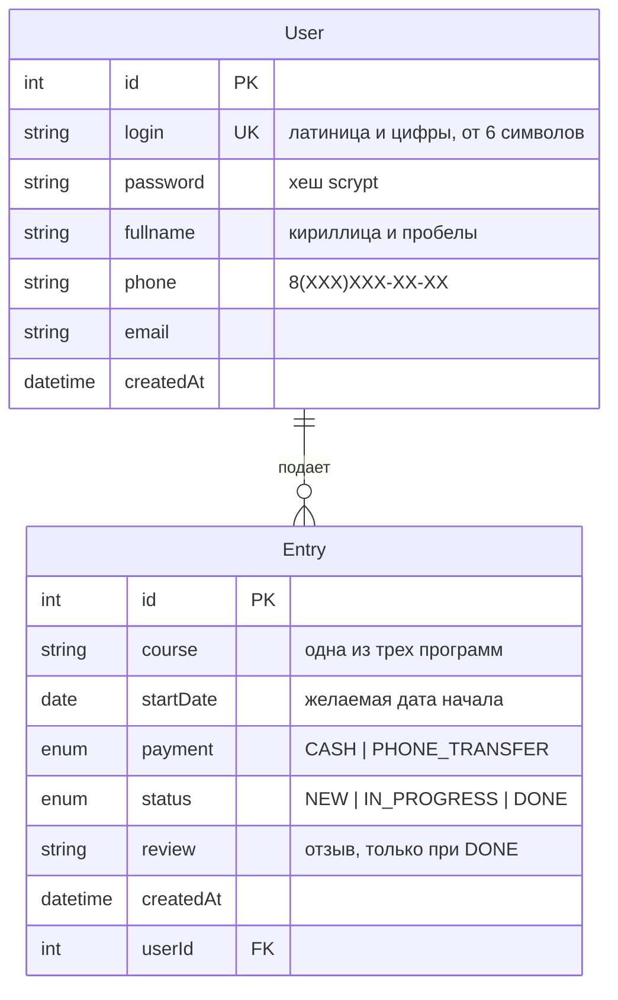

# ER-диаграмма базы данных «Корочки.есть»

Администратор — пользователь с логином `Admin` (пароль `KorokNET`), создается сидом `npm run db:seed`.

Для критерия «ER-диаграмма средствами СУБД» откройте базу `demo` (localhost:5431, postgres/postgres) в pgAdmin или DBeaver и постройте диаграмму по таблицам `User` и `Entry`.
